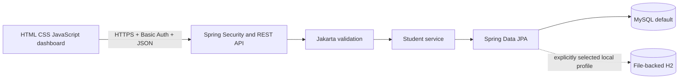
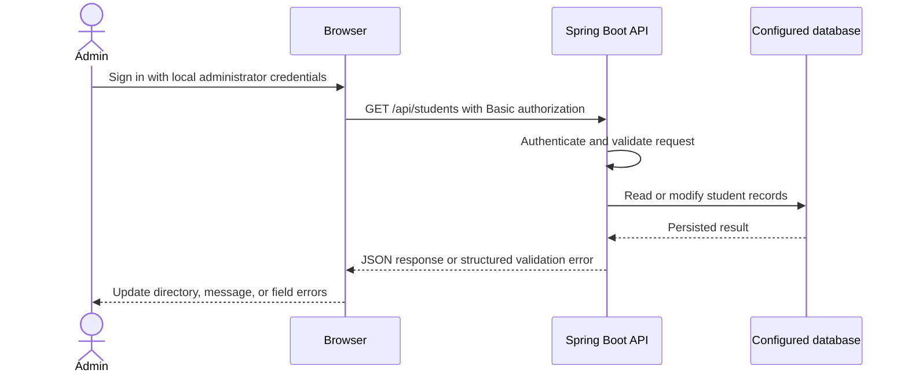
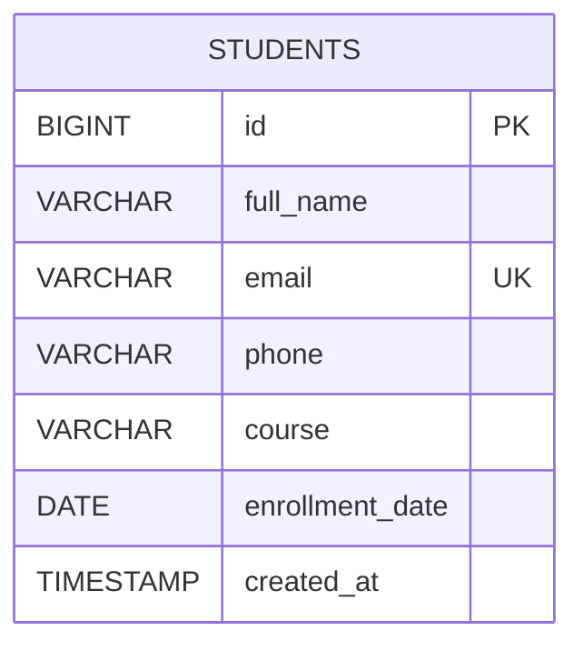
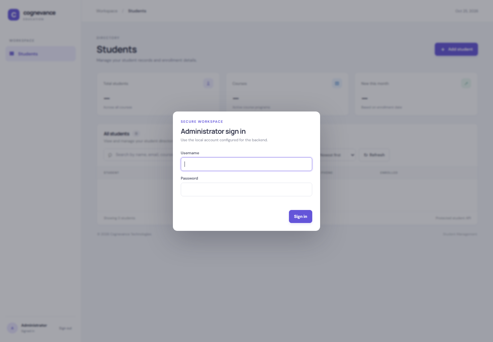

# Cognevance Student Management System

A Java full-stack student directory for maintaining enrollment records through a responsive browser dashboard and a Spring Boot REST API. MySQL 8 is the default runtime database. An explicit local H2 profile is available for isolated development and runtime checks when MySQL administrator setup is unavailable; it does not alter the default MySQL configuration.

## Features

- Create, view, update, delete, and search student records by name, email, course, or numeric ID.
- Server-side validation, case-insensitive duplicate email protection, useful field errors, and appropriate HTTP status codes.
- Responsive dashboard with loading, empty, success, and error states, student details, and confirmation before deletion.
- Directory controls for course filtering and sorting the current result set by newest, oldest, name, or course.
- Field-specific validation feedback, an in-app delete confirmation, and sign-out that clears in-memory authorization and protected UI data while discarding stale requests.
- Environment-based database and CORS configuration; no credentials are required in source files.
- CORS configuration rejects empty and wildcard origins; set the exact frontend origin when hosting.
- HTTP Basic administrator authentication for all student API routes, with BCrypt-encoded in-memory credentials from environment variables and a browser sign-in form.
- Status-only `/actuator/health` endpoint for service probes; student API routes stay authenticated.

The student API requires the configured single administrator account. The credential is loaded from environment variables and never persisted as an application user. The only public route is the status-only health probe. This is suitable for a controlled local demo; use HTTPS, managed identity lifecycle, rate limiting, and a durable user store before a public deployment.

## Technology and architecture

| Area | Stack |
| --- | --- |
| Backend | Java 17, Spring Boot 3.5.16, Spring Web, Spring Data JPA, Jakarta Validation |
| Runtime database | MySQL 8 (default); opt-in file-backed H2 profile for local development |
| Frontend | HTML, CSS, vanilla JavaScript modules |
| Verification | Maven, JUnit 5, Spring MockMvc, Node.js built-in test runner |

The browser calls the REST controller. DTO validation and service rules are applied before JPA persistence. Responses use DTOs, and centralized exception handling returns consistent JSON errors. See [architecture](docs/ARCHITECTURE.md), [setup](docs/SETUP.md), and [API reference](docs/API.md).





## Project structure

```text
backend/       Spring Boot application, configuration, and H2-backed tests
  src/main/    API, domain, persistence, and error handling
  src/test/    automated backend tests
  data/        ignored local-H2 files, created only by the local-h2 profile
 database/     MySQL schema and least-privilege application user setup
 docs/         architecture, API, setup, testing, and deployment notes
 frontend/     static dashboard, styles, and utility tests
 .github/      build and test workflow
.env.example  safe local variable template
```

## Prerequisites

- JDK 17 or newer, Maven 3.6 or newer.
- MySQL 8.x for the default runtime configuration, or use the opt-in H2 profile for local development.
- Python 3 (or another static HTTP server) to serve the frontend.
- Node.js 18 or newer for frontend checks.

## Run locally

For MySQL, follow [docs/SETUP.md](docs/SETUP.md) to initialize the project database and dedicated app user. Spring Boot does not load `.env` files automatically; set environment variables in the same PowerShell terminal used to launch Maven. Hibernate validates the MySQL schema and does not modify it.

Set the administrator credentials in the same PowerShell terminal before starting either profile. Use a unique username and a randomly generated password of at least 16 Unicode characters and no more than 72 UTF-8 bytes. The password is held in that terminal's process environment; do not put a real value in a script or commit it.

```powershell
$env:APP_AUTH_USERNAME = 'admin'
$securePassword = Read-Host 'Enter a unique local password (16+ characters)' -AsSecureString
$passwordPointer = [Runtime.InteropServices.Marshal]::SecureStringToBSTR($securePassword)
try { $env:APP_AUTH_PASSWORD = [Runtime.InteropServices.Marshal]::PtrToStringBSTR($passwordPointer) }
finally { [Runtime.InteropServices.Marshal]::ZeroFreeBSTR($passwordPointer) }
```

For a local isolated H2 runtime, run from the repository root:

```powershell
mvn -f backend/pom.xml -Plocal-h2 spring-boot:run '-Dspring-boot.run.profiles=local-h2'
```

This profile uses a persistent file database under ignored `backend/data/`. It is opt-in and does not replace or modify the MySQL defaults. To run against MySQL, omit `-Plocal-h2` and the profile argument.

In another PowerShell terminal, serve the frontend:

```powershell
python -m http.server 5500 --directory frontend
```

Open [http://localhost:5500](http://localhost:5500). The default API base URL is `http://localhost:8080/api`. For a different API origin, configure `window.STUDENT_API_BASE_URL` in `frontend/index.html` and allow that exact frontend origin with `CORS_ALLOWED_ORIGINS`. Never put database credentials in frontend files.

## API

Base URL: `http://localhost:8080/api`. See [docs/API.md](docs/API.md) for fields, examples, and error format.

| Method | Endpoint | Purpose | Success |
| --- | --- | --- | --- |
| GET | `/students` | List students | 200 |
| GET | `/students?q=asha` | Search records | 200 |
| GET | `/students/{id}` | Retrieve one record | 200 |
| POST | `/students` | Create a record | 201 |
| PUT | `/students/{id}` | Update a record | 200 |
| DELETE | `/students/{id}` | Delete a record | 204 |

The infrastructure probe `GET /actuator/health` is separate from student APIs. It returns only an overall status and is intentionally accessible without administrator credentials; component details are not exposed.

## Database model



## Tests and current verification

Run backend and frontend checks from the repository root:

```powershell
mvn -f backend/pom.xml test
mvn -f backend/pom.xml package
node --check frontend/js/app.js
node --check frontend/js/student-utils.mjs
node --test frontend/js/student-utils.test.mjs
```

See [docs/TESTING.md](docs/TESTING.md) for actual results and the distinction between automated tests, live H2 API checks, browser checks, and MySQL integration status.

**Verification (2026-10-25):** Maven verification passed (15 tests; package succeeded), Node syntax checks passed, and all 8 frontend utility tests passed. The real local UI was tested with the explicitly selected H2 profile: login, empty state, invalid email form validation, synthetic student create/list/search/course filter/details/edit/delete, logout, and rejected credentials. Browser console had no errors or warnings. A mobile-width overflow in the visually hidden table heading was fixed and the document now fits a 390px viewport; the wide student table remains scrollable within its wrapper. MySQL remains **not verified**: its service is running, but the project account previously received error 1045. See [TESTING.md](docs/TESTING.md) for the scope and evidence.

## Troubleshooting

- **MySQL schema validation failure:** use an authorized administrator to run `database/schema.sql` on the intended `student_management` schema.
- **MySQL error 1045:** verify credentials and account host grants locally. Do not reuse another project's database credentials. See [docs/SETUP.md](docs/SETUP.md).
- **Local H2 startup:** include both `-Plocal-h2` and `'-Dspring-boot.run.profiles=local-h2'`; generated files are stored under ignored `backend/data/`.
- **Frontend cannot reach API:** ensure the backend is listening on 8080 and `CORS_ALLOWED_ORIGINS` exactly matches the frontend origin.
- **Port conflict:** set `SERVER_PORT` or use another static-server port, then update CORS.
- **No npm on PATH:** the direct Node commands above run the existing utility tests without npm.

## Security and limitations

`.env` and `backend/data/` are ignored by Git; `.env.example` contains placeholders only. The backend refuses to start unless `APP_AUTH_USERNAME` is nonblank and `APP_AUTH_PASSWORD` contains at least 16 Unicode characters and no more than 72 UTF-8 bytes. Basic authentication must be used only over HTTPS outside localhost. Credentials are BCrypt-encoded in memory on startup, and the browser keeps its Basic authorization value in page memory only (refresh or sign-out clears it). Use a dedicated least-privilege database account. Avoid real student data in tests, source control, or screenshots. CORS is not authentication. The API currently returns all matching rows without pagination or server-side sorting; the dashboard applies sorting to the returned records and offers course filtering. It has no durable user management, authorization roles beyond administrator, audit history, managed migrations, or deployment automation. These are remaining production limitations.

## Deployment preparation

See [deployment readiness](docs/DEPLOYMENT.md) for current hosting constraints, environment configuration, and release checks. The project is not deployed and has no live URL. A GitHub Actions workflow is configured; its run status must be checked on GitHub separately.

## Screenshots

The sign-in view below is a genuine Chrome capture of the locally served application; it contains no credentials or student data. Authenticated dashboard and CRUD behavior was exercised separately with synthetic data; see [TESTING.md](docs/TESTING.md).



## License and project details

Project: Java full-stack student administration internship/portfolio application. Author: [Er-rahul3707](https://github.com/Er-rahul3707). See the repository's [MIT License](LICENSE).
